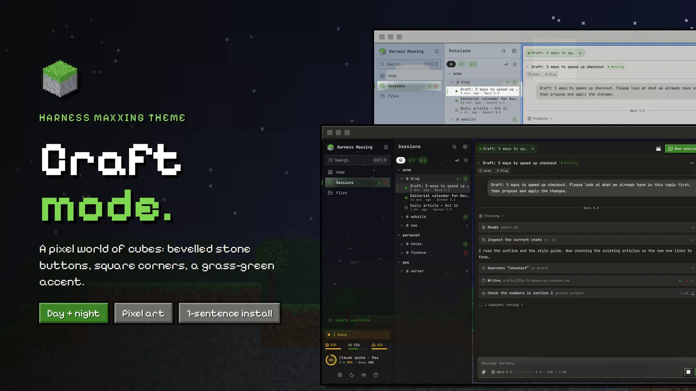
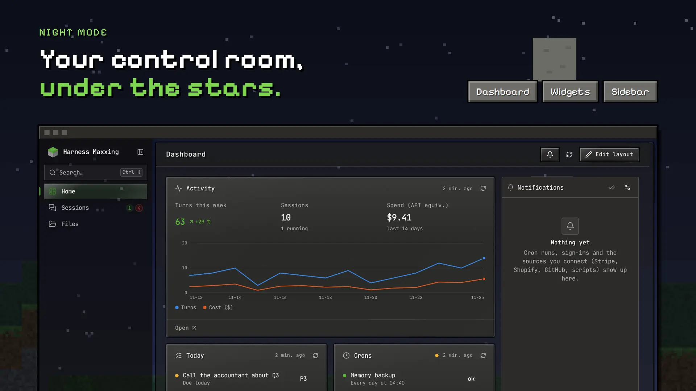
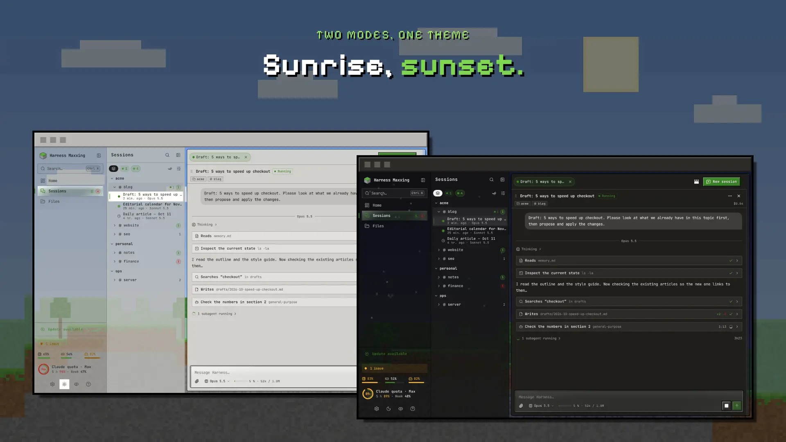
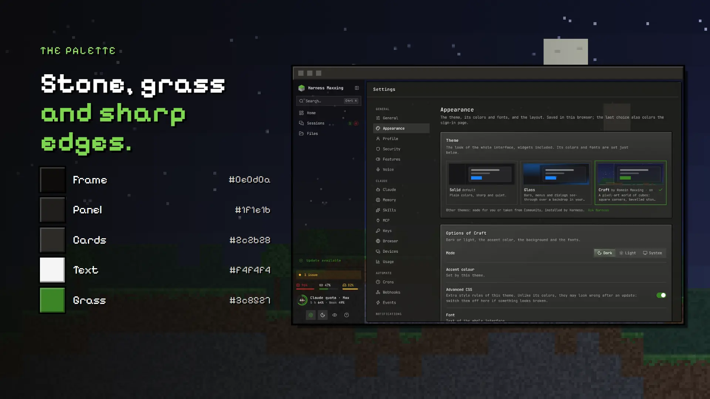
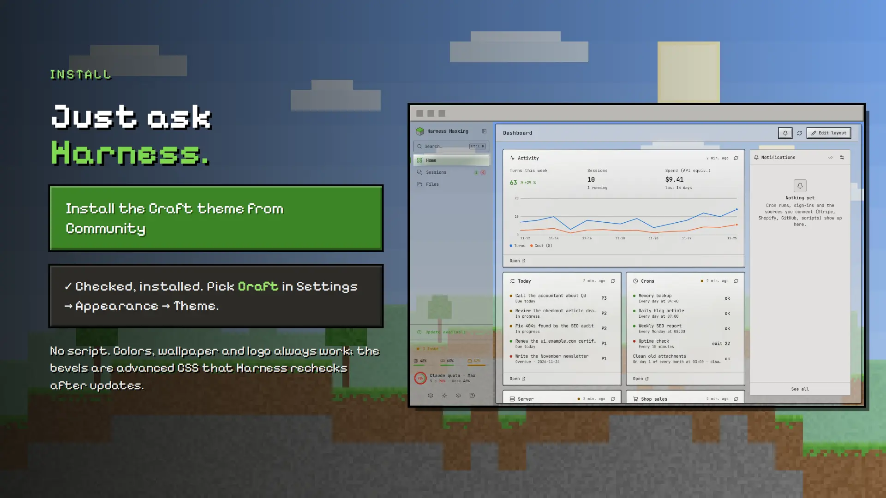

# Craft theme for Harness Maxxing

A pixel world of cubes for [Harness Maxxing](https://harness-maxxing.com): bevelled stone buttons like a game menu,
square corners, a grass-green accent, a sunny pixel landscape by day and a starry night after dark.



## Install

Ask Harness in any session:

> Install the theme https://github.com/romainmaxxing/harnessmaxxing-theme-craft

or from the server:

```bash
git clone --depth 1 https://github.com/romainmaxxing/harnessmaxxing-theme-craft /tmp/craft-theme
maxxing themes check /tmp/craft-theme
maxxing themes install /tmp/craft-theme
```

Then pick **Craft** in Settings -> Appearance -> Theme. Remove it with `maxxing themes remove craft`.

## What it sets

- **Glass** base with two pixel-art wallpapers: a day landscape of grass, dirt and stone blocks under square clouds,
  and the same world at night under the stars. It follows the light / dark mode of your system.
- Dark: frame `#0e0d0a`, panel `#1f1e1b`, cards `#2c2b28`, text `#f4f4f4`. Light: stone greys, text `#1b1b1b`.
- Grass-green accent `#3c8527`, 0 px corners, hard pixel shadows, JetBrains Mono for the interface and code.
- Its own logo (a grass-topped stone cube) in the sidebar while the theme is in use.
- **Advanced CSS** (small, visual only): bevelled buttons and cards that get a white outline on hover and sink when
  clicked, a pressed-in message box, shadowed headings, and more opaque bars so text stays readable over the
  wallpaper. Harness switches these rules off by itself after an update that changes the interface, until they are
  checked again; colors, wallpapers and logo always work. You can also switch them off in Settings -> Appearance.

No script, no network call, no outside font or image: every image was drawn for this theme.

## Screenshots






Raw captures: [`screenshots/`](screenshots/). Screenshots show demo data only.

An original pixel-art theme, not affiliated with or endorsed by any game publisher.

## License

MIT
